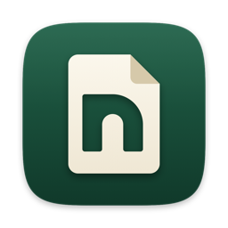
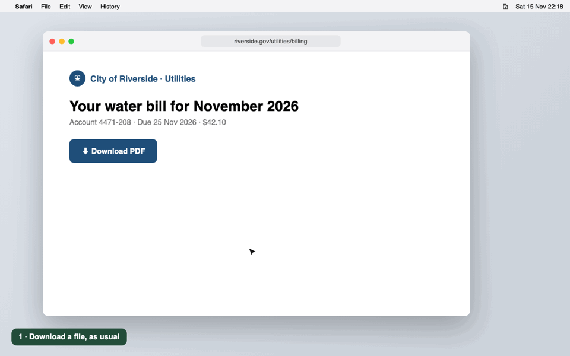

<p align="center">
  
</p>

<h1 align="center">neatly</h1>

<p align="center">
  <b>Clear names for your files, automatically.</b><br>
  An AI file renamer for Mac: downloads, screenshots and photos get real names and the right folder.<br>
  Private and on-device with Apple Intelligence. Free and open source.
</p>

<p align="center">
  <a href="https://github.com/alpozaydin/neatly/releases/latest"></a>
  
  
  
  
</p>

<p align="center">
  
</p>

## Install

```sh
curl -fsSL https://raw.githubusercontent.com/alpozaydin/neatly/main/scripts/install.sh | sh
```

If you have Homebrew:

```sh
brew install alpozaydin/tap/neatly && neatly service install
```

It lives in your menu bar and keeps itself up to date.

## What it does

|  |  |
|---|---|
| 📥 **Downloads** | A small popup suggests a name **and a folder**. Away? It keeps the new name and never makes you wait. |
| 📸 **Screenshots** | Named the moment you take them, by what's on screen. One click to undo. |
| 🏞️ **Photos** | Named by what they show, and where they were taken. |
| 🧹 **Tidy** | Clean up your Desktop, Downloads or any folder at once. You review every name first. |
| 🖱️ **Finder** | Select files → right-click → **Rename with neatly** (or Open With → neatly). |
| ↩️ **History** | Everything neatly changed, each with **Revert**. "Always do this" turns a choice into a rule. |
| 🎨 **Your style** | Natural names by default; short or long, dashes or spaces, dates, light or dark. |

## Real examples

<p align="center">
  
</p>

| Before | After |
|---|---|
| `Screenshot 2026-11-10 at 9.41.07.png` | **Turkish Airlines Boarding Pass**.png |
| `Screenshot 2026-11-12 at 18.02.55.png` | **Hubble Space Telescope**.png |
| `scan_20261104_8812.pdf` | **Rent Agreement**.pdf → *Documents* |
| `invoice_78123.pdf` | **Netflix Invoice Nov 2026**.pdf → *Bills* |
| `IMG_4108.HEIC` | **Colosseum in Rome**.heic |
| `IMG_4120.JPG` | **Galata Tower in Istanbul**.jpg |

Prefer `turkish-airlines-boarding-pass`? One click in settings.

## How it works

🔒 **Everything happens on your Mac.** neatly reads your files with Apple's on-device model. No account,
no tracking, no cloud AI. Nothing about your files is uploaded.

1. **Only junk names are touched.** `IMG_4821`, `Screenshot 2026-…`, `document (3)` get a name; names you chose never change.
2. **It reads as little as it can:** where the file came from, its title, page 1 of a PDF, the text on a screenshot.
3. **Simple rules first** for things like invoices, receipts and tickets: instant and predictable.
4. **Then Apple Intelligence**, on device, sees at most a page of text or the picture itself, and names what it is.
5. **Every answer is checked:** typos fixed from the file's own text, made-up words dropped. Not sure? It leaves the name alone.
6. **It learns your style** from the names you edit, and suggests the folder you'd pick.

Only three small things ever go online, never the files themselves:

- **Update check**: asks GitHub if there's a new version (only if you said yes).
- **Paper titles**: a research paper's arXiv number, to get its real title.
- **Photo places**: a phone photo's GPS coordinates (just the two numbers) go to Apple Maps, to name the place.

You can turn any of them off at any time: **More options → Look up papers and photo places online**, or the
update switch next to it. [Privacy details](docs/GUIDE.md#privacy)

## More

- 📖 [User guide](docs/GUIDE.md): every feature, setting and command
- 🛠️ [Development](docs/DEVELOPMENT.md): build from source, tests, releases

Needs a Mac with Apple silicon and macOS 26+. Turn on Apple Intelligence for the best names.
MIT licensed, made by [@alpozaydin](https://github.com/alpozaydin).
