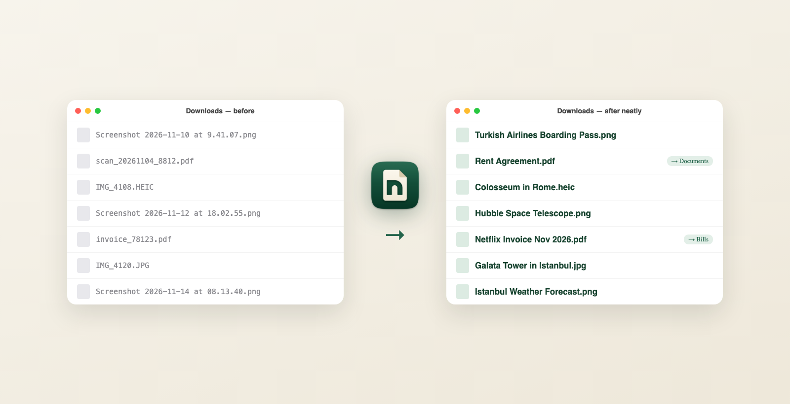
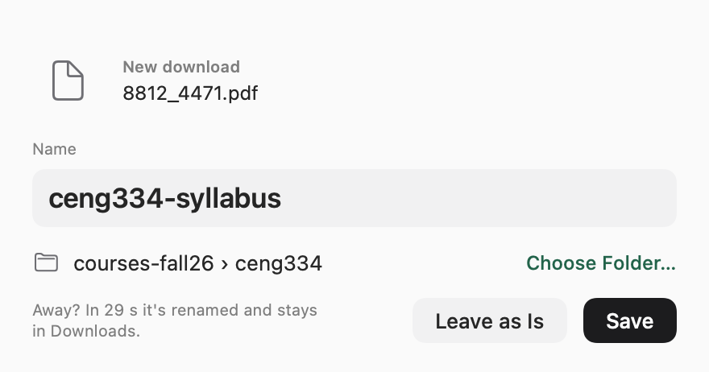

<p align="center">
  
</p>

<h1 align="center">neatly</h1>

<p align="center">
  <b>Clear names for your files, automatically.</b><br>
  Downloads, screenshots and photos get real names, and the right folder, right on your Mac.
</p>

<p align="center">
  <a href="https://github.com/alpozaydin/neatly/releases/latest"></a>
  
  
  
  
</p>

<p align="center">
  
</p>

## Install

```sh
curl -fsSL https://raw.githubusercontent.com/alpozaydin/neatly/main/scripts/install.sh | sh
```

or `brew install alpozaydin/tap/neatly && neatly service install`. It lives in your menu bar and keeps itself up to date.

## What it does

|  |  |
|---|---|
| 📥 **Downloads** | A small popup suggests a name **and a folder**. Away? It keeps the new name and never makes you wait. |
| 📸 **Screenshots** | Named the moment you take them, by what's on screen. One click to undo. |
| 🏞️ **Photos** | Named by what they show, and where they were taken. |
| 🧹 **Tidy** | Clean up your Desktop, Downloads or any folder at once. You review every name first. |
| ↩️ **History** | Everything neatly changed, each with **Revert**. "Always do this" turns a choice into a rule. |
| 🎨 **Your style** | Short or long names, dashes or Title Case, dates, light or dark. It learns from your edits. |

<p align="center">
  
</p>

## Real examples

| Before | After |
|---|---|
| `Screenshot 2026-11-10 at 9.41.07.png` | `turkish-airlines-boarding-pass.png` |
| `Screenshot 2026-11-12 at 18.02.55.png` | `corner-bakery-order.png` |
| `8812_4471.pdf` | `cs334-syllabus.pdf` → *courses/cs334* |
| `1234567_2026-11-04_124701.pdf` | `transcript-fall26.pdf` |
| `IMG_4108.HEIC` | `colosseum-in-rome.heic` |
| `IMG_4120.JPG` | `galata-tower-in-istanbul.jpg` |

## Private by design

🔒 Files are read and named **on your Mac**, with Apple's on-device model. No account, no tracking.
Only three small things ever go online: the update check, a paper's arXiv number (to get its title),
and a phone photo's location (to name the place). The last two can be switched off. [Details](docs/GUIDE.md#privacy)

## More

- 📖 [User guide](docs/GUIDE.md): every feature, setting and command
- 🛠️ [Development](docs/DEVELOPMENT.md): build from source, tests, releases

Needs a Mac with Apple silicon and macOS 26+. Turn on Apple Intelligence for the best names.
MIT licensed, made by [@alpozaydin](https://github.com/alpozaydin).
